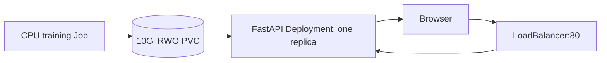

# MNIST on CPU Kubernetes

A PyTorch training Job writes a CNN checkpoint to persistent storage. A FastAPI Deployment reads that checkpoint and serves a same-origin browser UI for canvas, uploads, and held-out MNIST examples. No model weights are included in either source control or the inference image.



## Source and runtime

- `src/mnist_service/model.py`: shared two-convolution CNN and normalization.
- `train.py`: deterministic CPU training, evaluation, atomic state dictionary and JSON artifacts.
- `app.py`, `preprocess.py`, `static/index.html`: checkpoint validation, bounded API and browser UI.
- `docker/`: separate Python 3.11.14 Linux AMD64 images; PyTorch 2.9.1 CPU and torchvision 0.24.1 CPU.
- `k8s/gke/`: namespace, PVC, training Job, inference Deployment, public Service.
- `tests/`: model roundtrip, real forward pass, preprocessing, readiness, upload validation and manifest checks. Unit fixtures use random weights and do not measure accuracy.

## Local reproduction

Prerequisites: Git, Docker Engine/Desktop with Linux containers and Compose; Windows uses Docker Desktop's WSL2 backend. No GPU or GPU driver is required. On Linux, make the bind directory writable by UID/GID 10001 before starting (for example `mkdir -p artifacts && sudo chown 10001:10001 artifacts`).

```bash
docker compose up --build -d
docker compose logs -f train
docker compose ps -a
curl -f http://localhost:8000/readyz
```

Open [localhost:8000](http://localhost:8000). Compose waits for successful training before starting inference. Training defaults to three epochs, batch size 128, learning rate 0.001, seed 42, two CPU threads, and no loader workers. It evaluates the official 10,000-image test split after each epoch. It writes `model.pt`, `metadata.json`, `metrics.json` and ten actual held-out test examples into `artifacts/`; dataset downloads are cached there. Start a new training run only while inference is stopped, so metadata and weights cannot become inconsistent during loading.

```bash
# Recreate only inference, retaining the checkpoint and dataset.
docker compose up -d --no-deps --force-recreate inference
curl -f http://localhost:8000/readyz
docker compose down

# Unit/API/manifest checks in a Python 3.11 environment:
python -m pip install -r requirements/test.txt
python -m pytest -q
docker compose config --quiet
```

`/readyz` returns the checkpoint SHA-256; compare it before and after recreation. `metrics.json` contains actual measurements, versions, counts, timestamps and epoch results. Neither CI unit tests nor a build constitute a completed GKE training run.

## API

| Method | Path | Contract |
|---|---|---|
| GET | `/` | Browser UI, served from this backend |
| GET | `/healthz` | Process liveness |
| GET | `/readyz` | 200 only after hash-checked weights load; otherwise 503 |
| GET | `/api/metadata` | Model provenance and measured training metrics |
| GET | `/api/examples` | Test split IDs and actual labels |
| GET | `/api/examples/{id}/image` | Preview of an indexed test example |
| POST | `/api/predict/example/{id}` | Predict stored example; actual label returned separately |
| POST | `/api/predict` | Multipart `file`: PNG, JPEG, WebP |
| POST | `/api/predict/drawn` | JSON `{"pixels":[...]}`: exactly 784 finite values in [0,1] |

Predictions return `digit`, `confidence`, ten `probabilities`, `inference_ms` and checkpoint hash. `inference_ms` measures normalization plus model forward/softmax inside the serialized CPU execution lock; it excludes network transfer, decoding and queue wait. Confidence is a softmax score, not measured accuracy. Entire request bodies are bounded to 2 MiB; decoded images are bounded to four million pixels. Invalid inputs receive 4xx responses. Uploads are converted to grayscale, inverted when the border is light, cropped and fitted to 20×20 on a centered 28×28 dark image. Canvas pixels and stored test examples retain their 28×28 layout. All model inputs use MNIST normalization mean 0.1307/std 0.3081. Camera photos and unusual handwriting can be misclassified; no photo-domain accuracy is claimed.

```bash
curl -f http://localhost:8000/api/metadata
curl -f -X POST http://localhost:8000/api/predict/example/0
curl -f -F file=@artifacts/examples/0.png http://localhost:8000/api/predict
```

## Images and CI

GitHub Actions tests each change and builds both `linux/amd64` images. Pushes to `main` publish `sha-<full-commit>` and `main` tags using the job's scoped `GITHUB_TOKEN`:

- `ghcr.io/its-not-ganesh/cloud-ml-hw4-mnist-k8s-train`
- `ghcr.io/its-not-ganesh/cloud-ml-hw4-mnist-k8s-inference`

GHCR package visibility is independent of repository visibility. Both packages must be public and anonymously pullable before deployment. Use an empty Docker configuration for this check; do not insert registry credentials into Kubernetes manifests.

```bash
mkdir -p /tmp/mnist-anonymous
DOCKER_CONFIG=/tmp/mnist-anonymous docker pull ghcr.io/its-not-ganesh/cloud-ml-hw4-mnist-k8s-train:sha-$SHA
DOCKER_CONFIG=/tmp/mnist-anonymous docker pull ghcr.io/its-not-ganesh/cloud-ml-hw4-mnist-k8s-inference:sha-$SHA
python scripts/render_manifests.py --sha "$SHA"
```

The renderer replaces readable `main` defaults with an exact full commit tag in ignored `rendered/`. Evaluate only those immutable tags or image digests; record actual pod `imageID` values.

## GKE deployment

Prerequisites: an authorized Google Cloud project, active billing/eligible credits, configured budget email alerts, quota, gcloud, kubectl and the GKE auth plugin. Budget alerts are **not spending caps**. Inspect existing resources first. Enable `container.googleapis.com` and `compute.googleapis.com`. Create exactly one zonal Standard cluster with one CPU node, no autoscaling, one model PVC and one public load balancer. Set `PROJECT_ID`, `ZONE` (for example `us-east1-b`), and `SHA` to the evaluated image commit.

```bash
gcloud container clusters create mnist-hw4 --project "$PROJECT_ID" --zone "$ZONE" \
  --num-nodes=1 --machine-type=e2-standard-2 --disk-type=pd-balanced --disk-size=30 \
  --release-channel=regular --enable-ip-alias --enable-shielded-nodes \
  --addons=GcePersistentDiskCsiDriver --logging=NONE --monitoring=NONE
gcloud container clusters get-credentials mnist-hw4 --project "$PROJECT_ID" --zone "$ZONE"
kubectl get nodes
kubectl get storageclass standard-rwo
python scripts/render_manifests.py --sha "$SHA"
kubectl apply -f rendered/namespace.yaml
kubectl apply -f rendered/pvc.yaml
kubectl apply -f rendered/training-job.yaml
kubectl -n mnist-hw4 wait --for=condition=complete job/mnist-train --timeout=3600s
kubectl -n mnist-hw4 logs job/mnist-train
# Proceed only after Complete; no TTL removes the evidence-bearing Job.
kubectl apply -f rendered/inference-deployment.yaml
kubectl apply -f rendered/inference-service.yaml
kubectl -n mnist-hw4 rollout status deployment/mnist-inference --timeout=600s
kubectl -n mnist-hw4 get job,pod,deploy,svc,pvc -o wide
kubectl get pv
kubectl -n mnist-hw4 get svc mnist-inference -w
```

The Job writes as UID 10001 with `fsGroup: 10001`; inference mounts the same dynamically provisioned CSI PVC read-only. A pending PVC before the first consuming Pod is expected with `WaitForFirstConsumer`. Sequential training and inference plus one node avoid cross-node RWO attachment. Replace a completed Job only when deliberately starting a new run; its pod template is immutable.

When the Service receives an external IP, use `http://EXTERNAL_IP/`, verify `/healthz`, `/readyz`, all three UI modes, and inspect browser fetch requests. This direct-IP demonstration uses HTTP without TLS or authentication. Only intended UI/API endpoints are exposed; uploads are never written to public storage. It is a bounded demonstration, not a production public API with rate limiting or abuse protection.

## Persistence and self-healing verification

```bash
kubectl -n mnist-hw4 get pods -l app=mnist-inference -o wide
kubectl -n mnist-hw4 get pods -l app=mnist-inference -o jsonpath='{.items[0].metadata.uid}'
curl -f http://EXTERNAL_IP/readyz
# Delete only the named inference Pod shown above.
kubectl -n mnist-hw4 delete pod INFERENCE_POD_NAME
kubectl -n mnist-hw4 rollout status deployment/mnist-inference --timeout=600s
kubectl -n mnist-hw4 get pods -l app=mnist-inference -o wide
curl -f http://EXTERNAL_IP/readyz
curl -f -X POST http://EXTERNAL_IP/api/predict/example/0
```

Compare old/new Pod UIDs and checkpoint hashes. Probe the public endpoint during replacement to measure the outage. The Deployment/ReplicaSet creates a new Pod after deletion; the kubelet restarts a crashed container within a Pod; readiness removes an unhealthy Pod from Service endpoints. Startup/liveness probes make failed startup or processes observable and restartable. One replica has downtime during replacement. The PVC survives Pod recreation, but PVC deletion can delete the underlying disk. Neither a zonal disk nor a single-node cluster provides zone-level high availability.

For failures, inspect `kubectl -n mnist-hw4 describe pod POD`, `describe pvc mnist-model`, `get events --sort-by=.lastTimestamp`, Job logs, and actual image IDs. Check GHCR anonymous access for `ImagePullBackOff`, PVC permissions for write failures, and node memory/CPU for scheduling failures. Do not scale node count to work around issues without revisiting cost constraints.

## Teardown

Export the checkpoint and evidence before deletion. Confirm that the live URL and model disk are no longer needed. These commands delete the demonstration and its persisted data:

```bash
POD=$(kubectl -n mnist-hw4 get pods -l app=mnist-inference -o jsonpath='{.items[0].metadata.name}')
kubectl -n mnist-hw4 cp "$POD:/data/model.pt" ./model-backup.pt
kubectl -n mnist-hw4 delete service mnist-inference
kubectl -n mnist-hw4 delete deployment mnist-inference
kubectl -n mnist-hw4 delete job mnist-train
kubectl -n mnist-hw4 delete pvc mnist-model
gcloud container clusters delete mnist-hw4 --project "$PROJECT_ID" --zone "$ZONE"
gcloud compute disks list --project "$PROJECT_ID"
gcloud compute forwarding-rules list --project "$PROJECT_ID"
gcloud compute instances list --project "$PROJECT_ID"
```

Verify the matching load balancer, backing disk, node disk and VM are removed; leave unrelated resources untouched. Cloud billing usage can appear with delay.

## Sources

Original application code is MIT licensed. MNIST data is downloaded using torchvision and is not redistributed in the source repository. Upstream packages retain their own licenses.

- [MNIST dataset and original authors](https://yann.lecun.org/exdb/mnist/)
- [torchvision MNIST](https://docs.pytorch.org/vision/stable/generated/torchvision.datasets.MNIST.html)
- [Official PyTorch CPU version pairs](https://pytorch.org/get-started/previous-versions/)
- [PyTorch saving and loading](https://docs.pytorch.org/tutorials/beginner/saving_loading_models.html)
- [GKE persistent disks and CSI](https://docs.cloud.google.com/kubernetes-engine/docs/how-to/persistent-volumes/gce-pd-csi-driver)
- [Kubernetes probes](https://kubernetes.io/docs/tasks/configure-pod-container/configure-liveness-readiness-startup-probes/)
- [Cloud budget alerts](https://docs.cloud.google.com/billing/docs/how-to/budgets)
